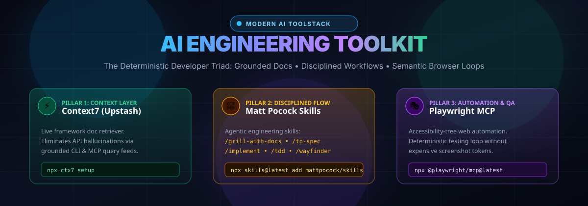
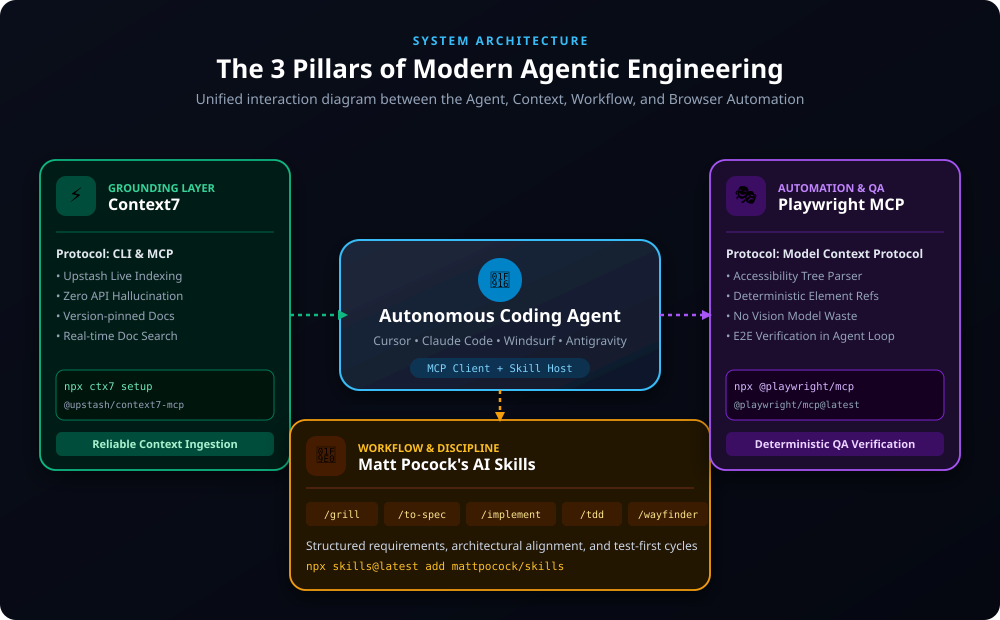
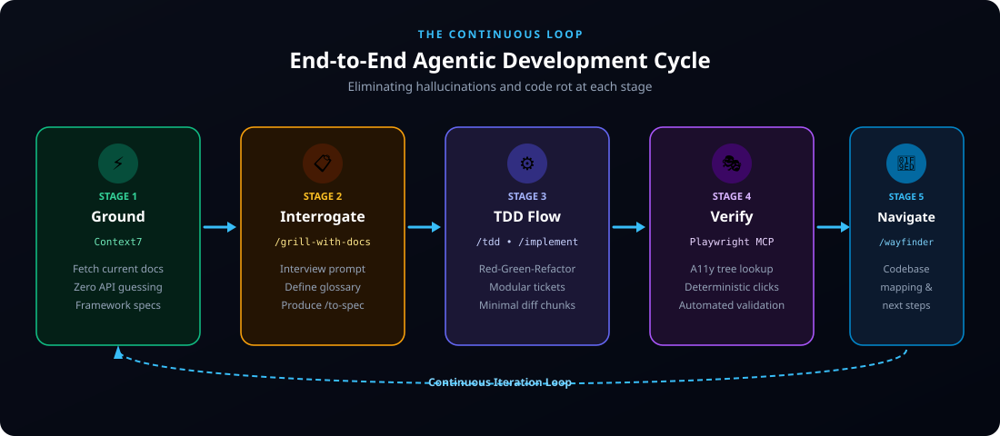
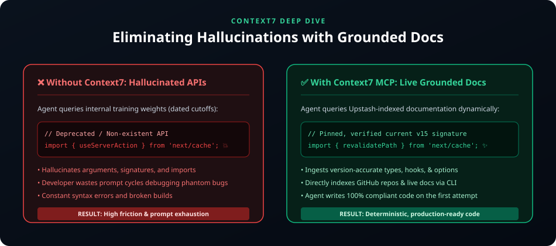
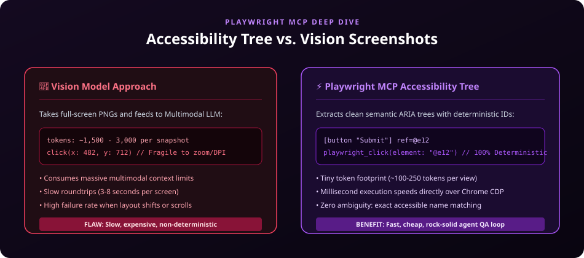
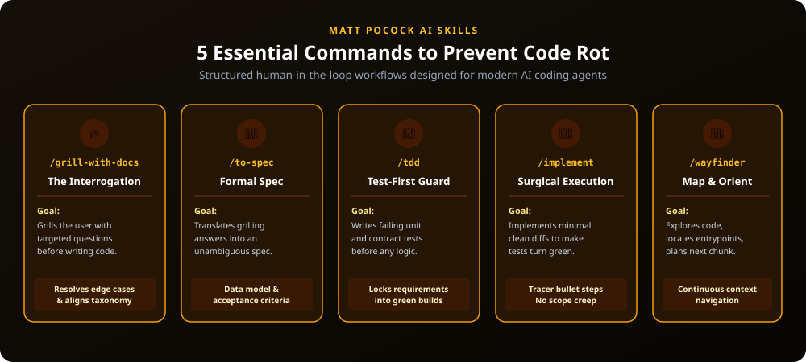

<div align="center">



# ⚡ AI Engineering Toolkit & Superpowers 🧠🎭⚡

**A production-grade developer reference & dashboard documenting the modern agentic AI engineering toolstack.**

[](https://rifaterdemsahin.github.io/AIToolkit/)
[-10b981?style=for-the-badge&logo=upstash)](https://github.com/upstash/context7)
[](https://github.com/microsoft/playwright)
[](https://github.com/mattpocock/skills)

---

### 🌐 [Explore the Live Web Dashboard](https://rifaterdemsahin.github.io/AIToolkit/) 🚀
*Features one-click command copy, interactive cheat sheet, responsive dark-mode UI, and architectural visualizers.*

---

</div>

## 📌 Executive Summary

Modern AI coding agents (like **Cursor**, **Claude Code**, **Windsurf**, and **Antigravity**) frequently suffer from two fatal weaknesses:
1. **API Hallucinations:** Inventing obsolete or non-existent methods from dated training data.
2. **AI Code Rot & Architectural Drift:** Unconstrained autonomous generations producing ungrounded, untested code blobs.

This repository unifies the **Triad of Agentic Superpowers** to build robust, deterministic, production-grade applications:

| Pillar | Technology | Protocol | Superpower |
| :--- | :--- | :--- | :--- |
| **1. Context Layer** ⚡ | **Context7** (Upstash) | CLI & MCP | Grounds the agent in real-time, version-pinned documentation. |
| **2. Automation & QA** 🎭 | **Playwright MCP** (`@playwright/mcp`) | MCP (ARIA Tree) | Fast, deterministic browser testing loop with zero screenshot token waste. |
| **3. Disciplined Flow** 🧠 | **Matt Pocock's AI Skills** | Agent Skills | Enforces senior engineer discipline (`/grill-with-docs`, `/to-spec`, `/tdd`, `/implement`). |

---

## 🏛️ System Architecture



```
                       ┌────────────────────────────────────────┐
                       │     Autonomous Coding Agent (LLM)      │
                       │ Cursor • Claude Code • Windsurf • AGY  │
                       └───────────────────┬────────────────────┘
                                           │
         ┌─────────────────────────────────┼─────────────────────────────────┐
         │                                 │                                 │
         ▼                                 ▼                                 ▼
┌──────────────────┐             ┌──────────────────┐             ┌──────────────────┐
│  CONTEXT LAYER   │             │ DISCIPLINED FLOW │             │  AUTOMATION & QA │
│  Context7 (MCP)  │             │   Matt Pocock    │             │  Playwright MCP  │
│ Upstash Live Docs│             │    AI Skills     │             │ A11y Tree Loop   │
└──────────────────┘             └──────────────────┘             └──────────────────┘
```

---

## 🔄 The Continuous Agentic Loop

Autonomous development requires a closed feedback loop: ground before designing, interrogate before coding, test before implementing, and verify in a real browser.



1. **⚡ Ground (Context7):** Retrieve exact, versioned API specifications.
2. **📋 Interrogate (`/grill-with-docs` & `/to-spec`):** Flush out edge cases, ambiguities, and define domain glossary.
3. **⚙️ Test-Driven Implementation (`/tdd` & `/implement`):** Write failing tests first, then write minimal code to turn them green.
4. **🎭 Verify (Playwright MCP):** Execute end-to-end browser workflows using the ARIA accessibility tree.
5. **🧭 Navigate (`/wayfinder`):** Map dependencies and prepare the next tracer-bullet ticket.

---

## ⚡ Superpower 1: Context7 (Upstash)

> **"Stop letting models hallucinate APIs that changed 2 years ago."**



Context7 bridges your agent directly to live documentation feeds maintained by Upstash. When your agent prompts for Next.js, Tailwind, LangChain, or Stripe, Context7 fetches current API signatures and markdown guides directly into context.

### 🚀 Setup Context7

#### Option A: Quick CLI Setup
```bash
npx ctx7 setup
```

#### Option B: MCP Server Configuration
Add to `.mcp.json` or `.cursor/mcp.json`:
```json
{
  "mcpServers": {
    "context7": {
      "command": "npx",
      "args": ["-y", "@upstash/context7-mcp@latest"]
    }
  }
}
```

📖 **Deep Dive**: See [docs/context7.md](docs/context7.md) for full configuration parameters.

---

## 🎭 Superpower 2: Playwright MCP (`@playwright/mcp`)

> **"Deterministic accessibility-tree browser control without burning tokens on screenshots."**



Traditional vision-based browser agents take high-resolution screenshots, consuming **1,500 to 3,000 tokens per action** while struggling with zoom levels and responsive breakpoints.

**Playwright MCP** streams a clean semantic **ARIA Accessibility Tree**:
- Every button, input, and link receives a deterministic reference ID (e.g., `@e4`).
- Actions (`click`, `fill`, `navigate`, `assert`) execute deterministically in milliseconds.
- Costs only **~150 tokens per snapshot** (90%+ cost reduction).

### 🚀 Setup Playwright MCP

```bash
npx @playwright/mcp@latest
```

Configuration in `.mcp.json`:
```json
{
  "mcpServers": {
    "playwright": {
      "command": "npx",
      "args": ["-y", "@playwright/mcp@latest"]
    }
  }
}
```

📖 **Deep Dive**: See [docs/playwright-mcp.md](docs/playwright-mcp.md) for agentic verification patterns.

---

## 🧠 Superpower 3: Matt Pocock's AI Skills

> **"Never let an AI agent write code until it has grilled you on what you actually want."**



Matt Pocock's AI Skills package encodes the habits of world-class staff engineers into standardized slash commands for your agent.

### 🚀 Installation

```bash
npx skills@latest add mattpocock/skills
```

### 📋 The 5 Essential Slash Commands

| Command | Category | Purpose |
| :--- | :--- | :--- |
| **`🔥 /grill-with-docs`** | Scope Discovery | Rapid-fire interview questions forcing you to define boundaries, taxonomy, and edge cases. |
| **`📝 /to-spec`** | Technical Spec | Synthesizes answers into formal markdown specs, data models, and acceptance criteria. |
| **`🧪 /tdd`** | Guardrails | Writes failing test harnesses (Jest, Vitest, Playwright) before feature logic is coded. |
| **`🚀 /implement`** | Execution | Surgical, single-responsibility code implementation to make the tests pass. |
| **`🧭 /wayfinder`** | Architecture | Explores unfamiliar repositories, maps file trees, and guides refactoring safely. |

📺 **Recommended Watch**: [AI Skills with Matt Pocock (YouTube)](https://www.youtube.com/watch?v=4DhcSPkEbwI) — Matt explains why disciplined skills prevent AI code rot.

📖 **Deep Dive**: See [docs/mattpocock-skills.md](docs/mattpocock-skills.md) and [docs/slash-commands-cheatsheet.md](docs/slash-commands-cheatsheet.md).

---

## ⚙️ Complete Client MCP Configuration

Save this file as `.mcp.json` in your repository root or copy into your editor:

```json
{
  "mcpServers": {
    "context7": {
      "command": "npx",
      "args": [
        "-y",
        "@upstash/context7-mcp@latest"
      ]
    },
    "playwright": {
      "command": "npx",
      "args": [
        "-y",
        "@playwright/mcp@latest"
      ]
    }
  }
}
```

### Supported IDEs & Clients:
- **Cursor**: Configure via `.cursor/mcp.json` or Settings &rarr; Features &rarr; MCP.
- **Claude Desktop / Claude Code**: Configure in `claude_desktop_config.json`.
- **Windsurf**: Configure in `~/.codeium/windsurf/mcp_config.json`.
- **VS Code (Cline / Roo Code)**: Configure in MCP settings tab.
- **Antigravity CLI**: Automatic discovery or project `.mcp.json`.

---

## 📁 Repository Structure

```tree
AIToolkit/
├── .cursor/
│   └── mcp.json                      # Cursor MCP server config
├── .github/
│   └── workflows/
│       └── deploy-pages.yml          # Automated GitHub Pages deploy action
├── assets/
│   ├── agentic-loop.svg              # Continuous development loop diagram
│   ├── architecture-overview.svg     # 3-pillar architectural diagram
│   ├── banner.svg                    # Repository hero graphic
│   ├── context7-diagram.svg          # Context7 grounding vs hallucination diagram
│   ├── playwright-tree-diagram.svg   # Accessibility tree vs screenshot diagram
│   └── workflow-skills.svg           # Matt Pocock's 5 skills lifecycle
├── docs/
│   ├── context7.md                   # Context7 documentation & usage guide
│   ├── mattpocock-skills.md          # Matt Pocock skills documentation & workflows
│   ├── playwright-mcp.md             # Playwright MCP technical documentation
│   └── slash-commands-cheatsheet.md  # Interactive command cheat sheet reference
├── .mcp.json                         # Root MCP server definition
├── claude_desktop_config.json        # Claude Desktop configuration template
├── index.html                        # Interactive Tailwind CSS dark-mode dashboard
└── README.md                         # Project documentation
```

---

## 🚀 One-Line Copy Commands

Copy and paste these commands into your terminal for instantaneous setup:

```bash
# 1. Install Matt Pocock's AI skills
npx skills@latest add mattpocock/skills

# 2. Setup Context7 CLI
npx ctx7 setup

# 3. Test Playwright MCP server
npx @playwright/mcp@latest --help
```

---

## 🌐 Live GitHub Pages Dashboard

The interactive dashboard is published and hosted on GitHub Pages:

👉 **[https://rifaterdemsahin.github.io/AIToolkit/](https://rifaterdemsahin.github.io/AIToolkit/)** 👈

---

## 🤝 Contributing & Community

Contributions are welcome! If you have additional AI skills, MCP integrations, or prompt recipes to share, open an issue or submit a pull request.

## 📄 License

MIT &copy; 2026 [Rifat Erdem Sahin](https://github.com/rifaterdemsahin)
