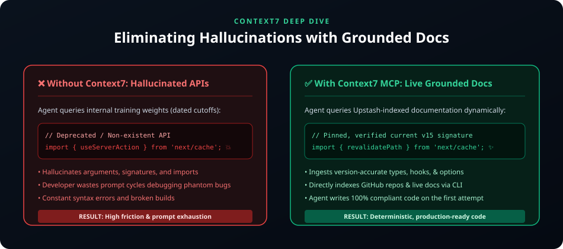

# ⚡ Context Layer: Context7 (Upstash)

> **Eliminating Hallucinations with Grounded, Version-Specific Framework Documentation**



---

## 🎯 What is Context7?

**Context7** (by Upstash) is a developer-centric context and documentation retriever for LLMs and AI coding agents (Cursor, Claude Code, Windsurf, Copilot, Antigravity).

Instead of relying on an LLM's frozen pre-training weights—which frequently invent outdated, deprecated, or completely fictional APIs—Context7 connects your agent to real-time, up-to-date documentation via CLI and the **Model Context Protocol (MCP)**.

---

## 🚀 Key Superpowers

- 🔍 **Live Grounded Search**: Queries official documentation in real-time.
- 📌 **Version Pinning**: Prevents mixing up Next.js 13 Pages router with Next.js 15 App router.
- 🚫 **Zero Hallucination**: Agents generate syntactically correct code on the first attempt.
- ⚡ **Instant Integration**: Works with Cursor, Claude Desktop, Claude Code, Cline, and Windsurf via standard MCP.

---

## 💻 Quick Setup

### 1. Run Setup CLI
```bash
npx ctx7 setup
```

### 2. Manual MCP Client Setup
Add to your client configuration (`.mcp.json` or Cursor settings):

```json
{
  "mcpServers": {
    "context7": {
      "command": "npx",
      "args": ["-y", "@upstash/context7-mcp@latest"]
    }
  }
}
```

---

## 🛠️ Usage in Agentic Loops

When prompting your coding agent, invoke Context7 directly:

```text
Use Context7 to fetch the latest documentation for Upstash Vector before implementing our search indexer.
```

Your agent will call the MCP tools:
1. `resolve-library-id` - Identifies the requested package and version.
2. `get-library-docs` - Fetches exact markdown guides and API signatures.
