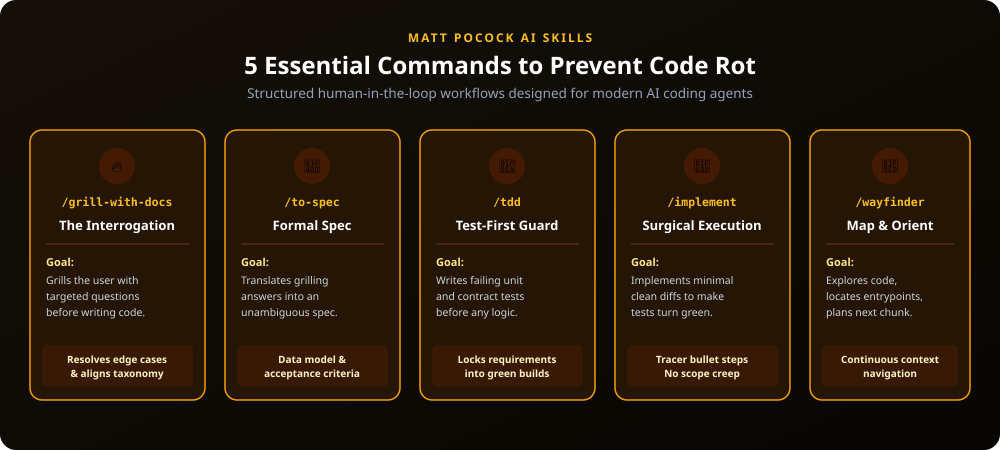

# 🧠 Disciplined Workflow: Matt Pocock's AI Skills

> **Preventing AI Code Rot through Structured Senior-Engineer Workflows**



---

## 🎯 Why AI Skills?

As demonstrated by Matt Pocock in [AI Skills with Matt Pocock](https://www.youtube.com/watch?v=4DhcSPkEbwI), unconstrained AI coding leads to:
1. Architectural drift and hallucinated domain concepts.
2. Huge "slop" pull requests that break existing code.
3. Phantom bugs and brittle solutions.

By installing **Matt Pocock's AI Skills (`mattpocock/skills`)**, your agent adopts disciplined human-in-the-loop workflows:
- **Interrogation before implementation**: Dig out ambiguities first.
- **Specification**: Formalize types, schemas, and acceptance criteria.
- **TDD (Test-Driven Development)**: Ensure tests fail first, then pass.
- **Tracer Bullets**: Build thin, end-to-end working slices rather than sprawling half-baked features.

---

## 🚀 Installation

Install the skills repository using `npx skills`:

```bash
npx skills@latest add mattpocock/skills
```

---

## 🛠️ The 5 Core Skills

| Skill Command | Phase | Core Purpose |
| :--- | :--- | :--- |
| `🔥 /grill-with-docs` | Discovery & Scope | Rapid-fire senior engineer interview questions to lock in requirements and eliminate false assumptions. |
| `📝 /to-spec` | Specification | Synthesizes answers into formal specs, glossary terms, and acceptance criteria. |
| `🧪 /tdd` | Quality Assurance | Implements red-green-refactor testing harnesses before application logic is written. |
| `🚀 /implement` | Execution | Surgical, single-responsibility code implementation satisfying the spec and tests. |
| `🧭 /wayfinder` | Architecture | Codebase mapping, directory navigation, and dependency boundary verification. |

---

## 📺 Recommended Watch
- 🎥 **Video Interview**: [AI Skills with Matt Pocock (YouTube)](https://www.youtube.com/watch?v=4DhcSPkEbwI)
- 💡 **Core Takeaway**: "Never let the agent write code until it has grilled you on what you actually want."
