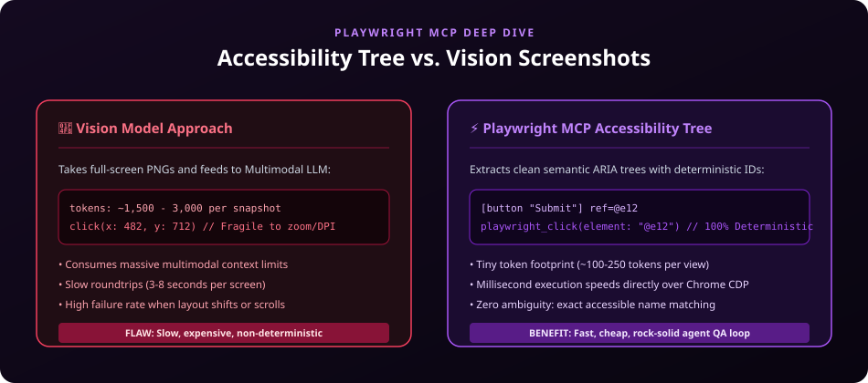

# 🎭 Browser Automation & QA: Playwright MCP

> **Deterministic Accessibility-Tree Browser Control for Agentic Verification Loops**



---

## 🎯 What is Playwright MCP?

**Playwright MCP** (`@playwright/mcp`) exposes the full power of Microsoft Playwright through the **Model Context Protocol (MCP)**.

Traditional AI browser agents take heavy screenshots (costing 1,500–3,000 multimodal tokens per screenshot) and guess pixel coordinates (which fail whenever zoom, layout, or font rendering changes).

**Playwright MCP takes a revolutionary semantic approach:**
- It extracts the browser's **Accessibility Tree (ARIA)** into a compact text snapshot.
- Elements receive unique reference handles (e.g. `@e12`).
- The agent clicks, types, navigates, and validates using exact accessibility handles—consuming 90% fewer tokens with 100% deterministic execution.

---

## 🚀 Key Superpowers

- 🌳 **Semantic ARIA Snapshots**: Compact, high-signal, zero pixel guessing.
- 💰 **Massive Token Savings**: ~150 tokens vs ~2,500 tokens for images.
- ⚡ **Ultra Fast**: Direct Chrome DevTools Protocol execution.
- 🔄 **Autonomous QA Verification Loop**: Agents can write code, run dev server, browse the page, fill forms, check assertions, and fix bugs autonomously.

---

## 💻 Quick Setup

### 1. Test via npx
```bash
npx @playwright/mcp@latest
```

### 2. Client MCP Configuration (`.mcp.json`)
```json
{
  "mcpServers": {
    "playwright": {
      "command": "npx",
      "args": ["-y", "@playwright/mcp@latest"]
    }
  }
}
```

---

## 🛠️ Typical Agent Loop Example

```text
1. Agent starts local dev server: npm run dev
2. Agent navigates: playwright_navigate("http://localhost:3000")
3. Agent inspects page: playwright_snapshot()
   -> Receives accessibility tree with element references
4. Agent interacts: playwright_click(element: "@submit-btn")
5. Agent verifies outcome: confirms success notification exists
```
